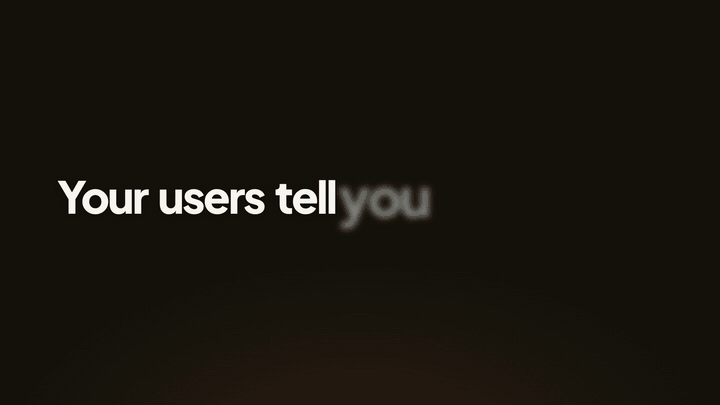

# Launch Video Kit

**Turn your website into an Apple-style launch video in your own brand, made by your coding agent.**

This is the system I use to make our launch films, rebuilt so it works for any product. Point it at your website. It pulls your colours, fonts, logo and copy into a brand kit. Then Claude Code or Codex writes the story from your own words and renders a 30 to 60 second launch film: a hook, your name on the music's drop, hero words cut on the voice, your product at close range, your logo in near silence.

The first version is free and needs no accounts: a placeholder narrator, a synthesised music bed and a synthesised sound palette. Swap in a real voice, music and footage when the story works.

**[Use this template](https://github.com/new?template_name=launch-video-kit&template_owner=timscheuerai)** · [Download ZIP](https://github.com/timscheuerai/launch-video-kit/archive/refs/heads/main.zip) · [All 10 skills](skills/README.md)



*The example film for Acme, a fictional brand, extracted from its website by the kit and rendered on the free path.*

## What you get

| Included | What it does for you |
|---|---|
| [Website to brand kit](skills/launch-brand/SKILL.md) | `npm run brand -- https://your-site.com` captures your colours by role, your fonts, your logo, your headline copy and screenshots, plus a preview sheet to check at a glance |
| [The film template](film/README.md) | A hook plus a shared body, drawn in your brand. The story lives in 1 JSON file; every picture cue lands on the narrator's words |
| [10 agent skills](skills/README.md) | Story, voice, music, sound, mix, review, motion and 3D, each a short manual your agent follows |
| A free audio path | Scratch voice, forced alignment, a scratch music bed on the bar grid, a synthesised sound palette and a -14 LUFS master |
| Paid upgrades, on your account | Narrator voices, music, sound kits and generated footage through Higgsfield, with the cost stated before every job ([costs](docs/costs.md)) |
| A review loop | A script that measures a render (cuts, static runs, loudness, beat grid) and writes a filmstrip and contact sheet, plus the eye checklist |
| A worked example | Acme: a fictional website, its extracted brand kit, 3 product screens and the finished film script |

## Start here

1. Click **[Use this template](https://github.com/new?template_name=launch-video-kit&template_owner=timscheuerai)** and clone your copy. Keep it private if you add unreleased product screens.
2. Install the tools ([setup](docs/setup.md), about 10 minutes on a Mac):

   ```bash
   brew install node ffmpeg uv whisper-cpp
   npm install
   uv venv .venv && uv pip install -r requirements.txt
   ```

3. Open the folder in Claude Code or Codex and paste:

   ```text
   Read AGENTS.md and README.md. Make a launch video for my product.
   Start with the launch-brand skill on https://YOUR-SITE.com and show me
   brand/preview.png; fix anything that reads wrong. Then use launch-film:
   draft the script from my website's own words, show me the beats and a
   contact sheet before rendering, and render the free version first.
   ```

Bring 3 or 4 screenshots or short screen recordings of your product. They carry the film.

## Or run the example by hand

```bash
npm run brand -- https://your-site.com                  # optional: your brand instead of Acme's
.venv/bin/python skills/launch-voice/scripts/scratch_voice.py film/film.json
.venv/bin/python skills/launch-voice/scripts/prep_lines.py film/film.json --align force   # precise word times; uv fetches torch once
.venv/bin/python skills/launch-score/scripts/scratch_bed.py film/score/bed.wav --bpm 120 --intro-bars 3
film/render.sh type-only
```

The film lands in `film/renders/type-only.mp4`. With your brand extracted, it is Acme's script and screens in your colours, fonts and logo. Replace the lines in `film/film.json` and the screens in `film/assets/screens/` to make it yours.

## How a film is built

```text
website ──> brand/brand.json ──┐
                               ├──> film/build.py ──> HyperFrames render ──> film/audio.py ──> master.mp4
film/film.json (lines, beats) ─┤        (every cue is a spoken word's time)     (music on the cut, voice,
voice takes ──> word times ────┘                                                 sound, -14 LUFS)
```

The **hook** is anything before the cut: 2 lines of type (free), your own footage, or generated footage. On the music's drop it cuts to the **body**, which is built from 6 beat types:

| Beat | On screen |
|---|---|
| `name` | Your logo and name punch in from 4x on the drop; the tagline writes in word by word |
| `hero` | Full-frame words on a dark, accent or light ground, each snapping in on its spoken word, leaving by a dive, a collapse or a cut |
| `product` | Your real screen in a window; the camera pushes into the part the voice names, with an optional cursor click and a chip |
| `blocks` | Your features land on their names, then close into 1 |
| `switch` | A card that turns on: "Feedback, on autopilot." |
| `end` | The lockup, then a quiet hold |

The body is shared by every hook, so testing 5 hooks is 5 small JSON files, and a change to the body reaches every film.

## Rules we learned the hard way

- Type that lands 0.1 to 0.3 s after its word reads as off beat. Time it by forced alignment, never by guesswork.
- 1 narrator for the whole film. A second voice for a new line breaks it, even when it is clearer.
- Show frames before building. A full render on the wrong look wastes a day.
- The whole app window at thumbnail size says nothing. Push into the one part the voice names.
- No text card where the animation already says it, and no monotone stretch longer than a few seconds.
- When photoreal people look fake, go stylised instead of cheaper.

More in [lessons](skills/launch-film/references/lessons.md).

## What is in the repo

```text
skills/     10 skills: launch-film (start here), launch-brand, story, voice, score, sound, mix, review, world, motion
tools/      brand-from-url.mjs, the website to brand kit extractor
brand/      your brand kit (ships with the Acme example)
film/       the template: film.json, hooks/, assets/screens/, templates/body.html, build.py, audio.py, render.sh
examples/   the fictional Acme website the example brand was extracted from
docs/       setup, costs, rights
```

Use it for your own brand. The extractor is meant for your own website, and the [rights notes](docs/rights.md) cover people, footage, music, fonts and claims.

Built by [Tim Scheuer](https://github.com/timscheuerai). [License](LICENSE) · [Third-party notices](THIRD_PARTY_NOTICES.md)
